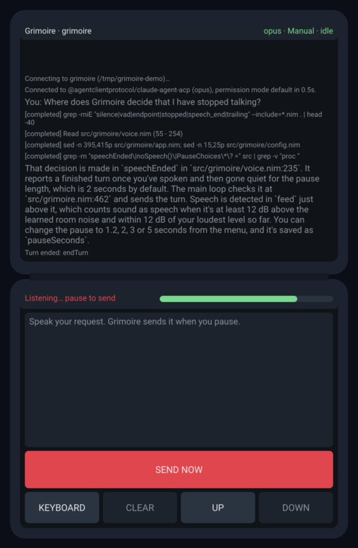

# Grimoire

Voice-control a coding agent from an Anbernic RG DS Plus.

<p align="center">
  
  &nbsp;
  
</p>

Tap TALK and speak. Grimoire sends your request when you pause, shows the
reply on the top screen, reads it aloud, and listens again.

Works with any [ACP](https://agentclientprotocol.com/) agent (Claude Code,
Gemini CLI, Codex and others). The agent runs on your computer; the handheld is
just the remote. Permission requests are answered by tapping a button.

## Build

Uses [Nimby](https://github.com/treeform/nimby) and Nix flakes.

```sh
mkdir grimoire-workspace && cd grimoire-workspace
nimby create
git clone https://github.com/monofuel/grimoire
cd grimoire
nimby sync nimby.lock
make desktop       # two X11 windows
make rg-ds-plus    # handheld build
make host-setup    # optional: Claude Code's ACP adapter, the default agent
```

## Run

Desktop:

```sh
make run
```

RG DS Plus (your computer connects to it over SSH; the handheld holds no keys):

```sh
make install-rg-ds-plus RG_DS_PLUS=<address>   # copy Grimoire to the handheld
make run-rg-ds-plus RG_DS_PLUS=<address>       # start it from your computer
make serve-rg-ds-plus RG_DS_PLUS=<address>     # or keep this running and open
                                               # Grimoire from the handheld's menu
```

Either way the agent runs on your computer. Set `GRIMOIRE_AGENT` (for example
`gemini --experimental-acp`), the SSH user and SSH options in `local.mk`.

## Configure

`~/.config/grimoire/config.json`:

```json
{
  "projects": [{"name": "grimoire", "cwd": "/path/on/the/agent/host"}],
  "sttUrl": "http://speech-server:8001/v1/chat/completions",
  "ttsUrl": "http://speech-server:8001/v1/audio/speech"
}
```

`agent` is the command that starts your ACP agent, for example
`["gemini", "--experimental-acp"]`; it defaults to Claude Code. Speech uses any
OpenAI-compatible endpoint, such as LFM3-Audio. Other keys: `mode`,
`pauseSeconds`, `instructions`, `sessionMeta`.

## License

MIT. Roboto is Apache 2.0.
