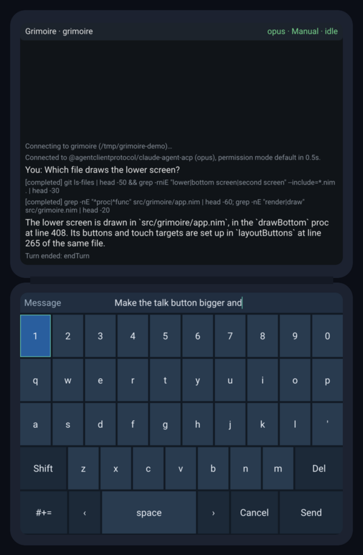

# Grimoire

Voice-control a coding agent from an Anbernic RG DS Plus.

<p align="center">
  
  &nbsp;
  
</p>

Tap TALK and speak. Grimoire sends your request when you pause, shows the
reply on the top screen, reads it aloud, and listens again. The agent runs on
your computer over [ACP](https://agentclientprotocol.com/); the handheld is
just the remote. Permission requests are answered by tapping a button.

## Build

Uses [Nimby](https://github.com/treeform/nimby) and Nix flakes.

```sh
mkdir grimoire-workspace && cd grimoire-workspace
nimby create
git clone https://github.com/monofuel/grimoire
cd grimoire
nimby sync nimby.lock
make desktop       # two X11 windows
make rg-ds-plus    # handheld build
make host-setup    # Claude Code ACP adapter
```

## Run

Grimoire is only the screens, microphone and speaker. The agent is Claude Code
(through `claude-agent-acp`, installed by `make host-setup`), and it always
runs on your computer with your own login and files.

**On a desktop**, `make run` opens Grimoire as two windows and starts the agent
as a local child process.

**On the RG DS Plus**, Grimoire runs on the handheld and the agent stays on your
computer. They talk over SSH from your computer to the handheld; the handheld
never connects back and holds no keys.

```sh
make install-rg-ds-plus RG_DS_PLUS=<address>
```

copies the Grimoire binary and its helper scripts to the handheld over SSH and
creates `~/.config/grimoire/config.json` there if it is missing. Edit its
`projects` to name a directory on your computer. The SSH user needs
passwordless `sudo` to install into `/usr/local/bin`.

Then start it one of two ways:

```sh
make run-rg-ds-plus RG_DS_PLUS=<address>
```

starts the agent on your computer, then over SSH stops the handheld's launcher
and runs Grimoire in its place. The agent's messages travel over that SSH
session. Quitting Grimoire restarts the launcher.

```sh
make serve-rg-ds-plus RG_DS_PLUS=<address>
```

keeps your computer ready instead: leave it running, then open Grimoire from
the handheld's launcher menu. Grimoire waits up to ten seconds for this
command to notice it over SSH; your computer then starts the agent and joins it
to Grimoire the same way.

Set `RG_DS_PLUS_USER`, `RG_DS_PLUS_SSH_OPTS` (for example a pinned
`UserKnownHostsFile`) and `GRIMOIRE_TARGET_LIBS` (the handheld's libraries for
the cross build) in an untracked `local.mk`.

## Configure

`~/.config/grimoire/config.json`:

```json
{
  "projects": [{"name": "grimoire", "cwd": "/path/on/the/agent/host"}],
  "sttUrl": "http://speech-server:8001/v1/chat/completions",
  "ttsUrl": "http://speech-server:8001/v1/audio/speech"
}
```

Speech uses any OpenAI-compatible endpoint, such as LFM3-Audio. Other keys:
`agent`, `mode`, `pauseSeconds`, `instructions`, `sessionMeta`.

## License

MIT. Roboto is Apache 2.0.
